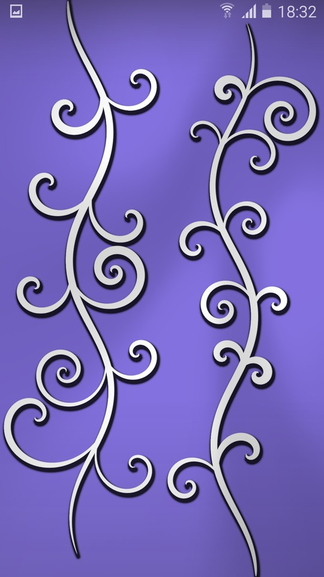
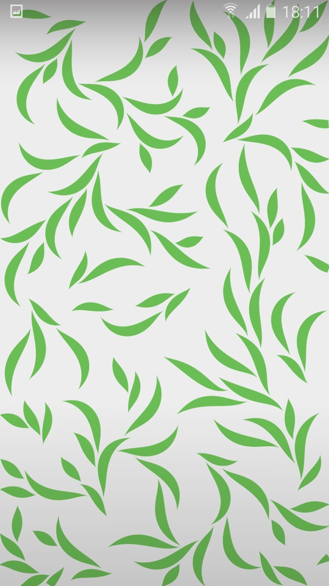
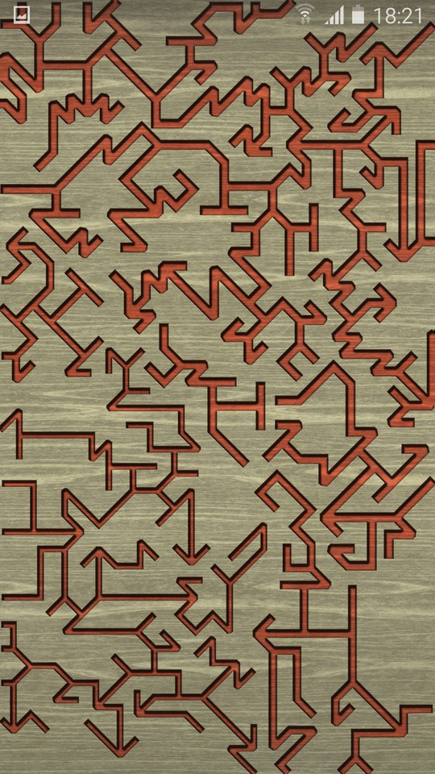
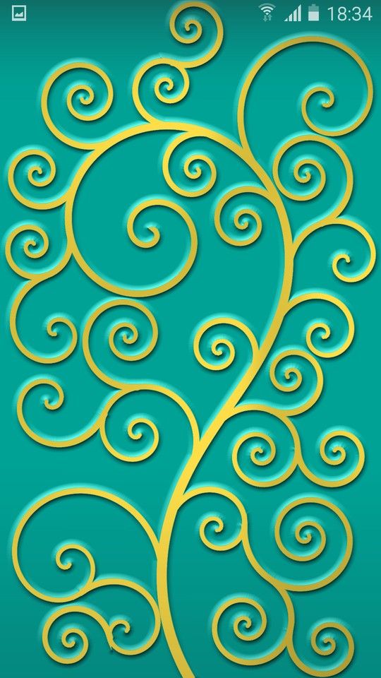
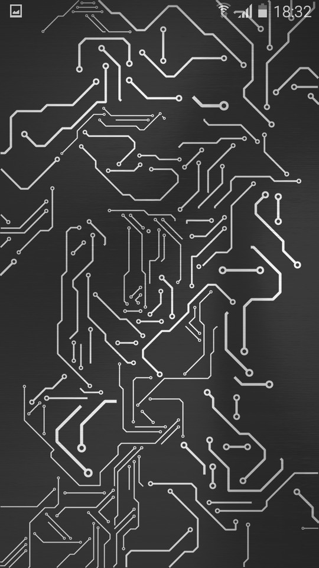
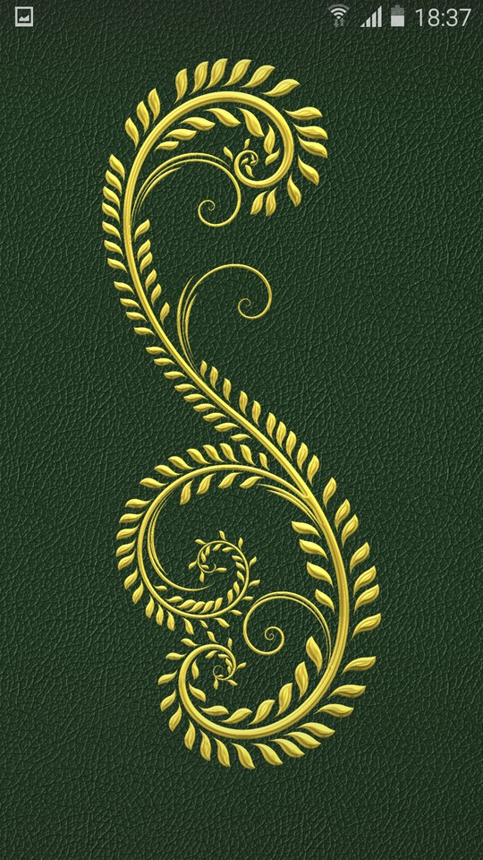
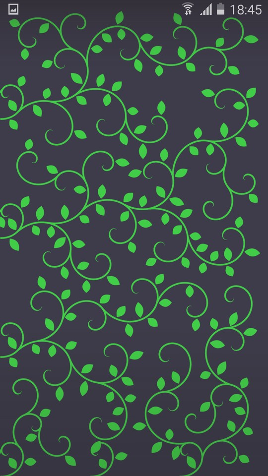
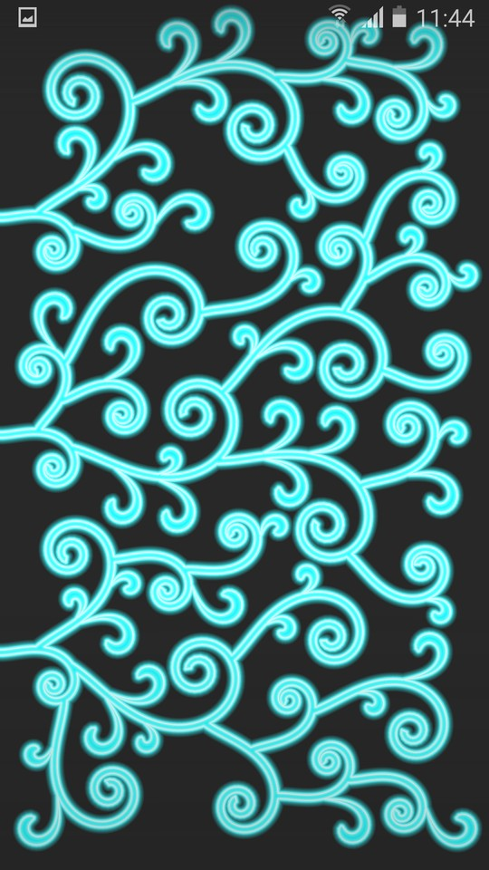

# Dworkin Live Wallpaper

Dworkin is a live wallpaper that draws intricate procedurally generated shapes that form unique pattern each time. Has wide variety of options for customization of pattern generation, colors, materials, and effects.

# Screenshots

       

# Video demonstration

# Features

Has wide variety of options for customization of pattern generation, colors, materials, and effects. Each option can be set to random (button with dice icon), that means random value is selected every time new pattern is drawn.

Materials and colors of both foreground and background can be set independently.
One or both colors can be set to random, in this case color harmonies are used to generate pleasing color combinations.

Features presets for all settings, and separately - for appearance (foreground and background materials + effect).
Plenty of built-in presets, with ability to add user presets.

New pattern starts drawing after certain amount of time has passed (defined by user).
Drawing of next pattern can also be initiated by double tap on the screen.

# Download

See [releases](https://github.com/webwarrior-ws/DworkinLWP/releases).

# Technical details

The drawing is implemented using OpenGL.

There are framebuffers for foreground and background, which are drawn onto once and are reused until either foreground or background property changes.

The pattern itself is generated progressively by agents. Each agent moves according to curvature function and draws a line (or trail of circles) of width determined by thickness function. Agents can also spawn other agents. Collision avoidance using quad trees is also used in some patterns.

The pattern is updated by drawing to SDF (signed distance field) framebuffer on each step. Only portions that are affected are updated. For exterior (positive distances), addition of new segments is done by suing `min()` function. For interior (negative distances), this trick doesn't work and SDF has to be re-calculated on each frame. Value in `b` channel is used as a kind of stencil to mark regions that need updating, to minimize re-calculation.

The final result is drawn by applying selected effect to the pattern with foreground and background textures. Since we already have SDF, calculation of effects such as bevel or glow is very cheap.

# Trivia

The wallpaper is named after character of "The Chronicles of Amber", Dworkin, who was the creator of the Pattern.
